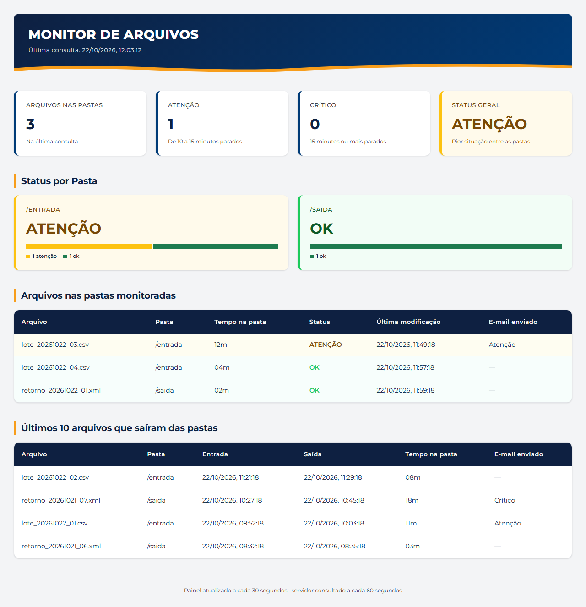

# Monitor de Arquivos SFTP

Ferramenta em PowerShell para monitoramento automatizado de arquivos parados em
pastas de um servidor remoto acessado por SFTP. Consulta as pastas, calcula há
quanto tempo cada arquivo está lá, publica o resultado em um painel web e envia
alertas por e-mail. **Nada é instalado no servidor monitorado**: a ferramenta só
lista nomes, tamanhos e datas, e roda em um segundo servidor.



> Painel com dados fictícios.

## Funcionalidades

- Consulta periódica das pastas por SFTP (WinSCP), com uma única sessão aberta;
- Alertas por e-mail de atenção (10 min) e crítico (15 min), configuráveis;
- Alerta quando o próprio monitoramento perde o acesso ao servidor;
- Log de auditoria com entrada, alteração e saída de cada arquivo;
- Painel web com status por pasta e os 10 últimos arquivos que saíram;
- Execução contínua como tarefa agendada do Windows, com recuperação automática;
- Modo simulado para testes e 42 verificações automatizadas das regras.

## Ganhos para a operação

- **Detecção sem depender de alguém olhando a pasta:** um arquivo parado vira
  alerta por e-mail em 10 e 15 minutos (valores configuráveis).
- **Nenhuma instalação no servidor monitorado:** acesso somente leitura por
  SFTP, compatível com ambientes sem agentes e sem pastas compartilhadas.
- **Rastreabilidade:** o log de auditoria responde quando cada arquivo chegou,
  mudou e saiu, com a janela de permanência (mínima e máxima).
- **Sem falso "tudo certo":** se o monitor perde o acesso, ele avisa. Falha de
  consulta nunca é tratada como arquivo processado.
- **Menos intervenção manual:** roda sozinho e se recupera em até 2 minutos
  depois de uma queda.
- **Regras confiáveis:** as regras de negócio têm testes automatizados, sem
  rede e sem esperar.

## Estrutura do repositório

```
01_fontes/v1.0.0/        # Código-fonte da aplicação
02_documentacao/v1.0.0/  # Documentação técnica
03_notas_versao/         # Changelog
```

## Uso

Detalhes de configuração, instalação e execução estão no
[README do código-fonte](01_fontes/v1.0.0/README.md).

Para experimentar sem servidor real, use o modo simulado descrito na seção 12
desse README.

> Os valores em `config.json.example` neste repositório são exemplos fictícios —
> substitua pelo servidor SFTP, pela fingerprint e pelo SMTP do seu ambiente
> antes de usar. Credenciais e dados reais nunca devem ser versionados.

## Stack

PowerShell 5.1 · WinSCP (.NET) · SMTP · JSON · HTML/CSS/JavaScript · Windows Task Scheduler

## Versão

Versão atual: 1.0.0 — veja o [CHANGELOG](03_notas_versao/CHANGELOG.MD).
